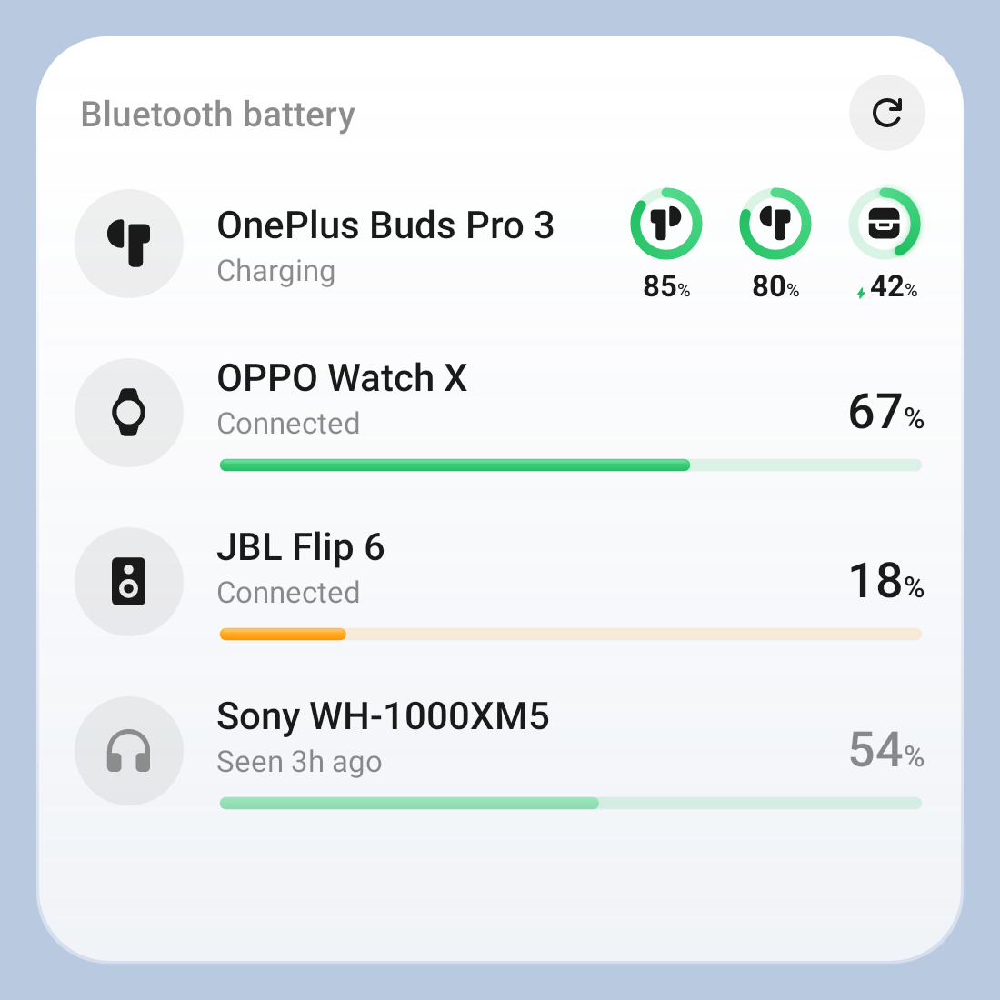
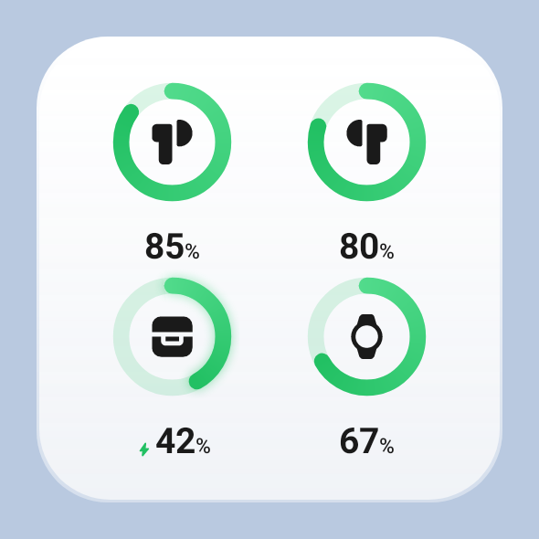
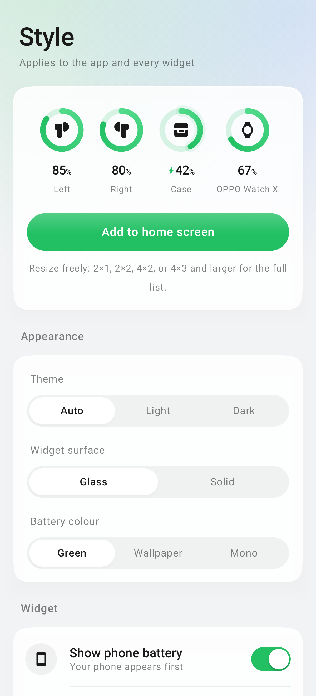

# Halo: Bluetooth battery widget

An Android widget + app that shows the battery of your connected Bluetooth gear: earbuds
(**left, right and case separately**), headphones, speakers, watches, keyboards, mice and
controllers. Car head units are filtered out.

Designed to sit natively on ColorOS 17: a neutral canvas with one restrained accent,
translucent cards lit from above (bright top hairline, soft bottom reflection, faint base
shadow), a light bloom where your finger presses, fully circular controls, capsule buttons, a
floating tab bar, bold battery bars, and the system font (OPPO Sans on ColorOS). Glow is
reserved for charging.

| Widget 4×2 | Widget 4×4 | Widget 2×2 |
|---|---|---|
|  |  |  |

| App | App (dark) | Style |
|---|---|---|
|  |  |  |

## Install
`dist/Halo-1.1.0.apk`: sideload it (allow "Install unknown apps"). Open Halo once, grant
**Nearby devices**, then long-press the home screen → Widgets → Halo (or tap *Place on home screen*
in the Style tab).

## Widget sizes
| Size | Layout |
|---|---|
| 2×1 / 4×1 | ring pills with percentages |
| 2×2 | up to four rings, number inside |
| 4×2 | ring row with labels + refresh |
| 4×3 and up | glass tile per device; earbuds show L / R / Case |

## Where the numbers come from
| Device | Source |
|---|---|
| Most headphones, speakers, buds (single level) | Android's own reported level (the status-bar one) |
| Earbud **left / right / case** | BLE adverts: Google **Fast Pair** battery notification (Pixel Buds, OnePlus/OPPO Enco, Sony, JBL, Jabra, Nothing…) and Apple proximity messages (AirPods, Beats) |
| Watches, bands, BLE peripherals | Standard BLE Battery Service (0x180F) |

Adverts use random addresses, so they're matched to your paired device by vendor, signal
strength, and agreement with Android's level. That keeps a stranger's AirPods from showing up as
yours. The case level is only broadcast while the lid is open, so Halo keeps the last value and
dims it once it is older than 30 minutes.

## Updating
* On every connect/disconnect (two passes: a few seconds after connecting, then again at 30 s)
* Every 15 minutes in the background
* Tap ⟳ on the widget, or pull down in the app
* **Live updates** (Style tab): a silent foreground service that follows changes within seconds

On ColorOS, allow background activity for Halo (App info → Battery usage) or the system may
pause it.

## Build
```
./gradlew :app:assembleRelease           # app/build/outputs/apk/release
./gradlew :app:testDebugUnitTest         # parser tests + screenshot previews → app/build/previews
```
The release build is signed with the debug key so it installs directly. Add your own
`signingConfig` before publishing.

Icons: [Material Symbols Rounded](https://github.com/google/material-design-icons) (Apache 2.0).

## Limits worth knowing
* Samsung Galaxy Buds and some brand-only earbuds use private protocols. They show the single
  Android level, not per-bud values.
* Android's battery and connection checks call two hidden `BluetoothDevice` methods by name.
  Both have been reachable on Android 9–16. If a future version blocks them, Halo falls back to
  profile queries for connection state.

## Code map
```
bt/       SystemBluetooth (connected + level) · BleBatteryScanner · AdParsers (Fast Pair, Apple)
          AdMatcher · GattBatteryReader · DeviceClassifier (types + car filter)
data/     BatteryRepository (merge & save) · HaloStore (DataStore)
widget/   HaloWidget (Glance layouts) · GaugeRenderer (glowing rings/capsules) · BatteryPalette
ui/       Compose app: Devices + Style pages, glass components, floating island
service/  ACL/boot receiver · LiveMonitorService      work/  RefreshWorker
```
