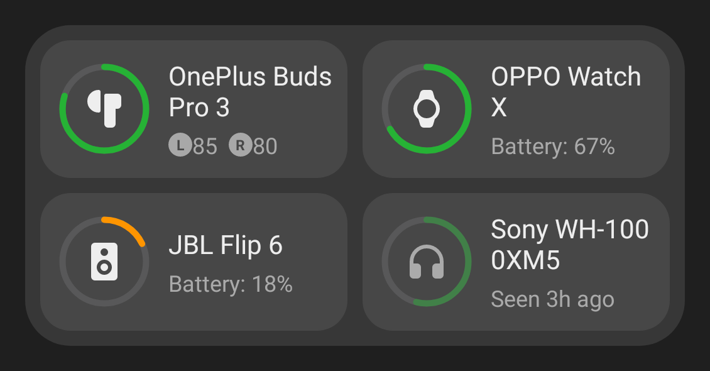
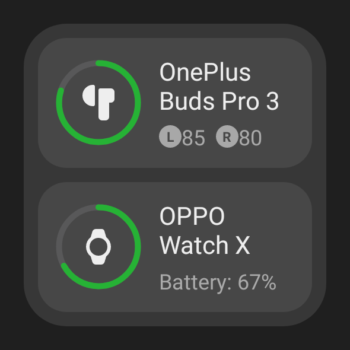
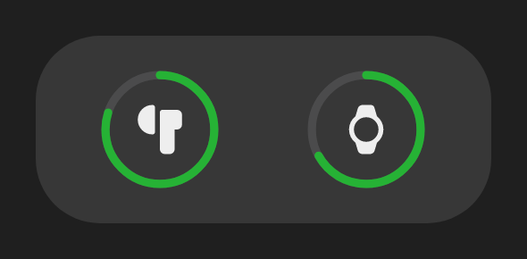
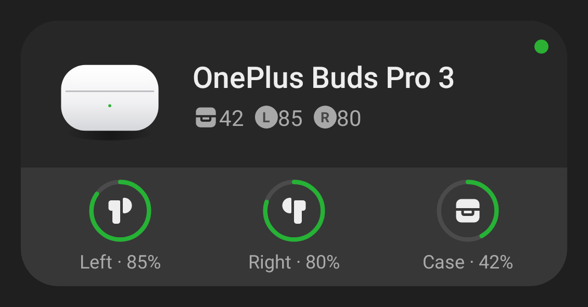
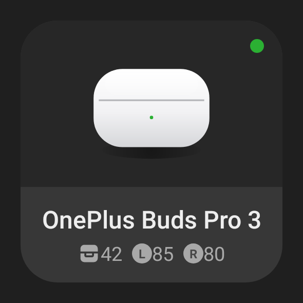
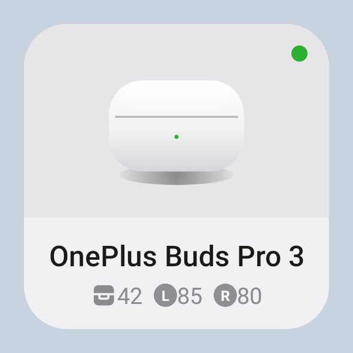
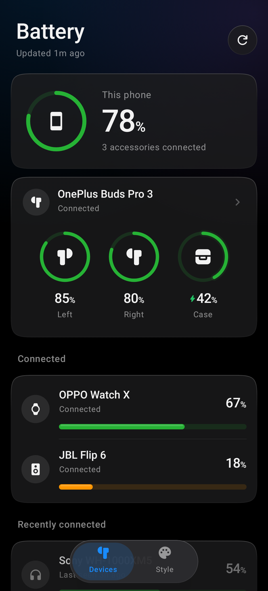
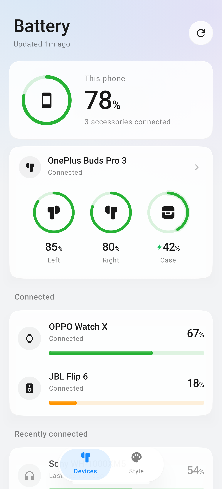
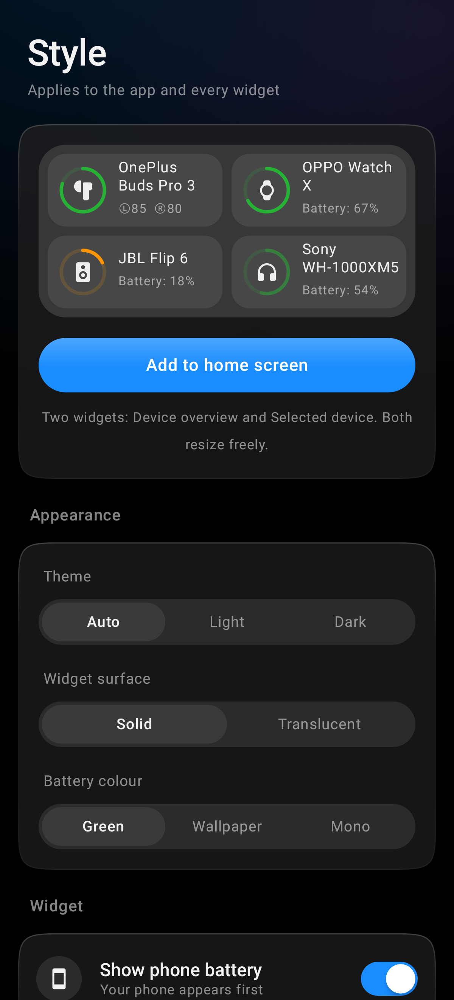

# Halo: Bluetooth battery widget

An Android widget + app that shows the battery of your connected Bluetooth gear: earbuds
(**left, right and case separately**), headphones, speakers, watches, keyboards, mice and
controllers. Car head units are filtered out.

Built to match ColorOS 17's own **My Devices** widgets: the colours, ring style, L/R badges and
layouts were sampled from the system widgets. The app around it follows ColorOS 17 too: neutral
glass cards lit from above, a touch-point light bloom, circular controls, the system blue accent,
a floating tab bar, and the system font (OPPO Sans on ColorOS).

### Widgets
Two widgets, each freely resizable:

**Device overview**: a tile per accessory.

| 4×2 | 2×2 | 2×1 |
|---|---|---|
|  |  |  |

**Selected device**: one accessory up close (earbuds first, then whatever is connected).

| 4×2 | 2×2 | 2×2 light |
|---|---|---|
|  |  |  |

### App
| Devices | Devices (light) | Style |
|---|---|---|
|  |  |  |

## Install
Download the APK from [Releases](https://github.com/sherifrahim/Halo-battery-Widget/releases/latest) (also at `dist/Halo-1.2.0.apk`) and sideload it (allow "Install unknown apps"). Open Halo once, grant
**Nearby devices**, then long-press the home screen → Widgets → Halo (or tap *Add to home screen*
in the Style tab).

## Where the numbers come from
| Device | Source |
|---|---|
| Most headphones, speakers, buds (single level) | Android's own reported level (the status-bar one) |
| Earbud **left / right / case** | BLE adverts: Google **Fast Pair** battery notification (Pixel Buds, OnePlus/OPPO Enco, Sony, JBL, Jabra, Nothing…) and Apple proximity messages (AirPods, Beats) |
| Watches, bands, BLE peripherals | Standard BLE Battery Service (0x180F) |

Adverts use random addresses, so they're matched to your paired device by vendor, signal
strength, and agreement with Android's level. That keeps a stranger's AirPods from showing up as
yours. The case level is only broadcast while the lid is open, so Halo keeps the last value and
dims it once it is older than 30 minutes.

## Updating
* On every connect/disconnect (two passes: a few seconds after connecting, then again at 30 s)
* Every 15 minutes in the background
* Tap ⟳ on the widget, or pull down in the app
* **Live updates** (Style tab): a silent foreground service that follows changes within seconds

On ColorOS, allow background activity for Halo (App info → Battery usage) or the system may
pause it.

## Build
```
./gradlew :app:assembleRelease           # app/build/outputs/apk/release
./gradlew :app:testDebugUnitTest         # parser tests + screenshot previews → app/build/previews
```
The release build is signed with the debug key so it installs directly. Add your own
`signingConfig` before publishing.

Icons: [Material Symbols Rounded](https://github.com/google/material-design-icons) (Apache 2.0).

## Limits worth knowing
* The Selected device widget can't show a photo of your exact model, as ColorOS does, because
  Bluetooth doesn't report the model. Earbuds get a rendered case; other devices a large icon.
* Samsung Galaxy Buds and some brand-only earbuds use private protocols. They show the single
  Android level, not per-bud values.
* Android's battery and connection checks call two hidden `BluetoothDevice` methods by name.
  Both have been reachable on Android 9–16. If a future version blocks them, Halo falls back to
  profile queries for connection state.

## Code map
```
bt/       SystemBluetooth (connected + level) · BleBatteryScanner · AdParsers (Fast Pair, Apple)
          AdMatcher · GattBatteryReader · DeviceClassifier (types + car filter)
data/     BatteryRepository (merge & save) · HaloStore (DataStore)
widget/   HaloWidget (Glance layouts) · GaugeRenderer (glowing rings/capsules) · BatteryPalette
ui/       Compose app: Devices + Style pages, glass components, floating island
service/  ACL/boot receiver · LiveMonitorService      work/  RefreshWorker
```
